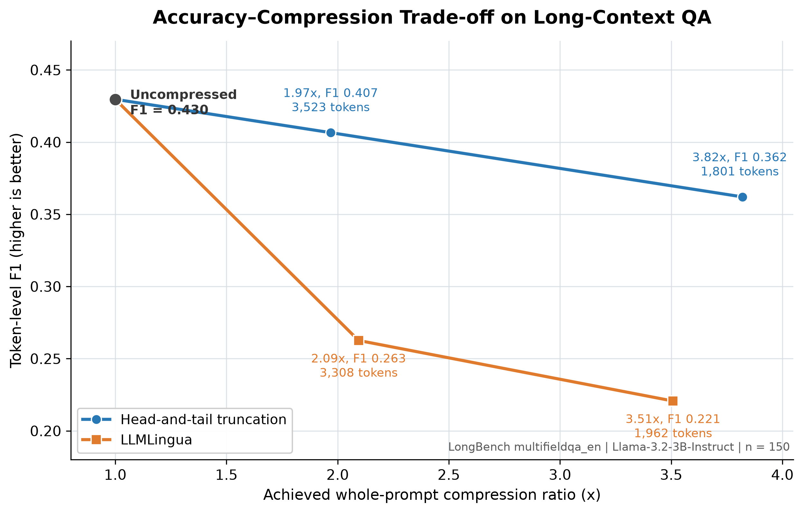

# CISC7021-Group38
CISC7021 Group38 Course Project

> **Note**：每一節英文段落下方均附中文對照說明，兩者如有出入以英文為準。

## Project

Study of prompt-compression methods for long-context QA with
`Llama-3.2-3B-Instruct` on LongBench `multifieldqa_en`. Three methods are compared
under an identical sample index, prompt template and metric implementation
(see [plan.md](./plan.md) for the full division of work):

| Part | Method | Owner | Status |
| --- | --- | --- | --- |
| [part1_uncompressed](./part1_uncompressed) | No compression (full context baseline) | Member 1 | Done — 150/150, EM 0.0933 / F1 0.4296 |
| [part2_truncation](./part2_truncation) | Head-and-tail truncation (2x / 4x) | Member 2 | Done — 150/150 at both ratios, EM 0.0733 / 0.0667, F1 0.4065 / 0.3620 |
| [part3_llmlingua](./part3_llmlingua) | LLMLingua (2x / 4x) | Member 3 | Done — 150/150 at both ratios, EM 0.0067 / 0.0133, F1 0.2626 / 0.2207 |

> 本專案比較三種 prompt 壓縮方法 —— 在 LongBench
> `multifieldqa_en` 上以 `Llama-3.2-3B-Instruct` 做長文本問答。三人使用完全相同
> 的樣本索引、prompt 模板與評分實作，確保三份結果可互相對照（分工見
> [plan.md](./plan.md)）。Part 1 已完成 150/150 筆（EM 0.0933 / F1 0.4296）；
> Part 2 的 2x 與 4x 亦各完成 150/150 筆（EM 0.0733 / 0.0667，F1 0.4065 /
> 0.3620）；Part 3 的 2x 與 4x 各完成 150/150 筆（EM 0.0067 / 0.0133，F1
> 0.2626 / 0.2207），共產生 300 筆正式 LLMLingua 評估結果。

## Key results

All numbers below are read from the committed result files, not re-typed by hand.

| Method | n | EM | F1 | Mean prompt tokens | Whole-prompt ratio | Compression (s) | Generation (s) | Total (s) |
| --- | ---: | ---: | ---: | ---: | ---: | ---: | ---: | ---: |
| Uncompressed (Part 1) | 150 | 0.0933 | 0.4296 | 6 966.8 | 1.000 | 0.000 | 4.634 | 4.647 |
| Head-tail 2x (Part 2) | 150 | 0.0733 | 0.4065 | 3 523.1 | 1.969 | 0.019 | 5.793 | 5.822 |
| Head-tail 4x (Part 2) | 150 | 0.0667 | 0.3620 | 1 801.2 | 3.820 | 0.018 | 3.523 | 3.546 |
| LLMLingua 2x (Part 3) | 150 | 0.0067 | 0.2626 | 3 308.1 | 2.094 | 10.816 | 3.017 | 13.839 |
| LLMLingua 4x (Part 3) | 150 | 0.0133 | 0.2207 | 1 961.6 | 3.508 | 9.846 | 2.130 | 11.980 |

Sources: [Part 1](./part1_uncompressed/results_member1.json) ·
[Part 2 2x](./part2_truncation/results_member2_2x.json) ·
[Part 2 4x](./part2_truncation/results_member2_4x.json) ·
[Part 3](./part3_llmlingua/results_member3.json) ·
[same-environment rerun and combined table](./results_same_machine/README.md).

The table above reports the **per-part runs**, which happened on three different
machines. A second, single-environment run of all five settings is documented in
[`results_same_machine/`](./results_same_machine/README.md); its quality metrics
reproduce the table above within 0.0075 F1, and it is the only valid source for
cross-method latency. Use it for every RQ3 claim.

- Head-and-tail truncation loses 5.4% relative F1 at 2x and 15.7% at 4x while
  removing 49% and 74% of the prompt tokens. All 150 samples were truncated in
  both settings, as intended, so Part 1 really is the uncompressed reference.
- Part 2 reports two ratios: the **document** ratio (achieved 2.000 / 4.000) and
  the **whole-prompt** ratio (1.969 / 3.820), because the instruction and the
  question are always kept.
- LLMLingua 4x reduced mean generation latency by 29.4% relative to LLMLingua
  2x, while token F1 decreased by 16.0%. Its very low EM reflects strict exact
  matching of generated answers, so F1 is the more informative quality metric.
- Latencies come from different hardware — Part 1 on a local RTX 3060, Part 2
  on a Colab T4, and Part 3 on Apple M5 Pro MPS, all `float16` — so compare
  token counts and quality across parts, not absolute seconds. Use the
  [same-environment rerun](#same-environment-rerun-latency-baseline) below for
  every latency comparison instead.

> 上表數字直接取自各結果檔（非人手抄錄）。頭尾截斷在 2x 只損失 5.4% 相對 F1、
> 4x 損失 15.7%，但分別減少 49% 與 74% 的 prompt token；兩個設定的 150 筆全部
> 有截斷，符合方法設計，因此 Part 1 確實是完全不壓縮的基準。Part 2 同時記錄
> 「文章壓縮比」（實得 2.000 / 4.000）與「整個 prompt 壓縮比」（1.969 /
> 3.820），因為指令與問題一律保留。LLMLingua 的 2x 與 4x 各完成 150 筆；4x
> 相比 2x 的生成延遲降低 29.4%，但 F1 下降 16.0%。EM 採用嚴格字串匹配，因此
> LLMLingua 應主要參考 F1。延遲來自不同硬體（Part 1 本機 RTX 3060、Part 2
> Colab T4、Part 3 Apple M5 Pro MPS，皆 `float16`），跨部分請比較 token 數與
> 品質，不要比較絕對秒數；延遲比較一律改用下節的同環境重跑結果。

## Same-environment rerun (latency baseline)

Because the three per-part runs used different hardware, [`run_all.py`](./run_all.py)
re-runs all five settings in one process on one GPU and writes to
[`results_same_machine/`](./results_same_machine). Quality reproduces the table
above within 0.0075 F1; what changes materially is the latency picture.

| Method | n | EM | F1 | Total lat (s) | vs uncompressed |
| --- | ---: | ---: | ---: | ---: | ---: |
| Uncompressed | 150 | 0.1000 | 0.4350 | 9.43 | — |
| Head-tail 2x | 150 | 0.0733 | 0.3990 | 5.32 | −43.6% |
| Head-tail 4x | 150 | 0.0667 | 0.3633 | 3.23 | −65.7% |
| LLMLingua 2x | 150 | 0.0067 | 0.2569 | 13.57 | +43.9% |
| LLMLingua 4x | 150 | 0.0067 | 0.2221 | 10.76 | +14.1% |

Head-and-tail truncation is effectively free (0.019–0.020 s of compression) and
cuts end-to-end latency by 44% and 66%. LLMLingua spends 6.7–7.5 s per question
inside the compressor, which is more than its generation saving can repay: at 2x
it is 44% **slower** than the uncompressed baseline despite removing 52% of the
prompt tokens. The rerun also makes the paired contrast Uncompressed → Head-tail
2x significant (−0.0360, CI [−0.069, −0.003]) where the per-part run was not, so
that pair should be reported as a small loss at the edge of significance.

> 由於三次原始實驗使用不同硬體，`run_all.py` 會在單一程序、單一 GPU 上重跑
> 全部五個設定，輸出到 `results_same_machine/`。品質指標與上表相差在 0.0075 F1
> 以內，真正改變的是延遲結果。頭尾截斷的壓縮幾乎不耗時（0.019–0.020 秒），
> 端到端延遲分別降低 44% 與 66%；LLMLingua 每題要花 6.7–7.5 秒在 compressor
> 上，遠超過生成階段省下的時間，因此 2x 雖然減少 52% 的 prompt token，端到端
> 反而比不壓縮慢 44%。重跑也讓 Uncompressed → Head-tail 2x 的配對比較變成顯著
> （−0.0360，信賴區間 [−0.069, −0.003]），而原始跑並未達顯著，因此這一組應
> 描述為「損失很小、位於顯著性邊緣」。完整表格、配對信賴區間與重現比較見
> [`results_same_machine/README.md`](./results_same_machine/README.md)。

## Accuracy–compression trade-off



The figure is generated directly from the committed result JSON files by
[`part3_llmlingua/plot_accuracy_compression.py`](./part3_llmlingua/plot_accuracy_compression.py).
Increasing compression reduces token-level F1 for both methods. Head-and-tail
truncation retains most of the baseline quality at approximately 2x compression
(0.4296 to 0.4065 F1) and declines to 0.3620 at approximately 4x. Under this
project's implementation, LLMLingua reaches 0.2626 and 0.2207 F1 at its 2x and
4x settings, respectively, so it does not outperform the simpler truncation
baseline at a comparable token budget.

This result is specific to the present implementation and must not be treated as
a general conclusion that LLMLingua is inferior. The Phi-2 compressor has a
shorter context window than the input prompts, causing 296 of the 300 compressed
rows to be processed in chunks (mean 6.3 chunks). This differs from the
whole-prompt setting of the original method and is an important experimental
limitation. The vector version of the figure is available as
[`accuracy_compression_tradeoff.pdf`](./figures/accuracy_compression_tradeoff.pdf).
Four paired success and failure examples are documented in
[`part3_llmlingua/qualitative_cases.md`](./part3_llmlingua/qualitative_cases.md).
They are selected and regenerated from the committed JSON files by
[`build_qualitative_cases.py`](./part3_llmlingua/build_qualitative_cases.py),
with the complete 20-row data table saved as
[`qualitative_cases.csv`](./part3_llmlingua/qualitative_cases.csv).

> 圖中的橫軸越向右代表壓縮越強，縱軸越高代表問答 F1 越好。兩種方法均隨壓縮
> 增強而下降；在本次實作中，head-and-tail truncation 在相近 token 預算下明顯
> 高於 LLMLingua，因此 RQ1 與 RQ2 均可由此圖回答。不過這不能解讀為
> 「LLMLingua 普遍較差」：Phi-2 compressor 的 context window 較短，300 筆結果中
> 有 296 筆需要分塊壓縮（平均 6.3 個 chunks），與原論文的完整 prompt 設定不同，
> 必須在最終報告中列為實驗限制。圖表由結果 JSON 自動產生，並同時提供 PNG 與
> PDF 版本。

## Repository layout

| Path | Description |
| --- | --- |
| [shared/](./shared) | Sample index, prompt template, metrics and config shared by all members |
| [part1_uncompressed/](./part1_uncompressed) | Uncompressed baseline pipeline + 150-sample results ([README](./part1_uncompressed/README.md)) |
| [part2_truncation/](./part2_truncation) | Head-and-tail truncation + 2x/4x results ([README](./part2_truncation/README.md), [table generator](./part2_truncation/make_table.py)) |
| [part3_llmlingua/](./part3_llmlingua) | Two-stage LLMLingua pipeline + full 2x/4x results ([README](./part3_llmlingua/README.md)) |
| [results_same_machine/](./results_same_machine) | Single-GPU rerun of all five settings; the only valid source for cross-method latency ([README](./results_same_machine/README.md)) |
| [run_all.py](./run_all.py) | Driver that reruns Parts 1–3 in one environment and writes `results_same_machine/` |
| [figures/](./figures) | Automatically generated accuracy--compression figure in PNG and PDF formats |
| [acl_latex.tex](./acl_latex.tex) | ACL two-column review report (Phase 1) |
| [plan.md](./plan.md) | Work split and shared interface |
| [project.md](./project.md) | Course project requirements |
| [CHECKLIST.md](./CHECKLIST.md) | Requirement-by-requirement completion checklist with recomputed metrics |

> `shared/` 是三人共用的樣本索引、prompt 模板、評分方式與參數設定；
> `part1_uncompressed/` 是不壓縮基準流程與 150 筆結果；`part2_truncation/` 是
> 頭尾截斷與 2x/4x 結果；`part3_llmlingua/` 是兩階段 LLMLingua 流程與完整結果；
> `results_same_machine/` 是同一張 GPU 上重跑五個設定的結果，也是跨方法延遲的
> 唯一有效來源，`run_all.py` 則是一次跑完 Part 1–3 的驅動程式；
> `acl_latex.tex` 為 ACL 格式回顧報告；`plan.md` 為分工與共用介面；
> `project.md` 為課程專案要求；`CHECKLIST.md` 為逐項需求完成度核對表。

## Quick start

Parts 1 and 2 share one environment; Part 3 needs two environments because
LLMLingua 0.2.2 pins an older `transformers` than Llama 3.2 requires.

```powershell
# Shared setup: project-local venv + shared sample index
python -m venv .venv
.\.venv\Scripts\python.exe -m pip install -r part1_uncompressed\requirements.txt
.\.venv\Scripts\python.exe shared/prepare_samples.py
```

```powershell
# Part 1 — uncompressed baseline (≈12 min for 150 samples on an RTX 3060)
.\.venv\Scripts\python.exe part1_uncompressed\run_baseline.py --limit 5 --device cuda --dtype float16
.\.venv\Scripts\python.exe part1_uncompressed\run_baseline.py --device cuda --dtype float16

# Part 2 — head-and-tail truncation at 2x and 4x, then rebuild the table
.\.venv\Scripts\python.exe part2_truncation\run_truncation.py --ratio 2 --dtype float16
.\.venv\Scripts\python.exe part2_truncation\run_truncation.py --ratio 4 --dtype float16
.\.venv\Scripts\python.exe part2_truncation\make_table.py

# Part 3 — LLMLingua: compress first, then evaluate (separate requirements)
python -m pip install -r part3_llmlingua\requirements.txt
python part3_llmlingua\run_llmlingua.py compress --device cuda --compressor-chunk-tokens 1400
python -m pip install -r part3_llmlingua\requirements_evaluate.txt
python part3_llmlingua\run_llmlingua.py evaluate --device cuda --dtype float16
```

```powershell
# All five settings in one environment, then the combined table (for RQ3 latency)
.\.venv\Scripts\python.exe run_all.py --limit 3     # smoke test
.\.venv\Scripts\python.exe run_all.py               # full resumable run
.\.venv\Scripts\python.exe part2_truncation\make_table.py --rerun-dir results_same_machine
```

`run_all.py` needs an environment where both `llmlingua` and a Llama-3.2-capable
`transformers` import together; it patches the Phi-2 key/value cache API for
newer `transformers` versions. It writes to `results_same_machine/` and never
modifies the per-part result files.

Every runner is resumable: it writes one `.jsonl` record per sample and skips
completed ids on re-run (pass `--no-resume` to start over). Full flags and output
formats are in [Part 1](./part1_uncompressed/README.md),
[Part 2](./part2_truncation/README.md) and
[Part 3](./part3_llmlingua/README.md). On a CPU-only machine install
`torch --index-url https://download.pytorch.org/whl/cpu` and drop
`--device cuda --dtype float16` (≈152 s/sample instead of ≈4.6 s). Part 3 needs
Python 3.10–3.12 and follows the Colab T4 instructions in its own README.

> 建立專案專屬 `.venv`（不動到全域 Python）、安裝相依套件、下載並建立共用樣本
> 索引，先跑 5 筆確認環境正常，再跑完整 150 筆。Part 1、Part 2 共用同一環境；
> Part 3 因為 LLMLingua 0.2.2 綁定較舊的 `transformers`，所以壓縮與評估分兩個
> 環境（兩條指令各自在獨立 Python 程序執行）。所有 runner 都支援續跑：每題寫入
> 一筆 `.jsonl`，重跑會跳過已完成的 id（`--no-resume` 可從頭開始）。完整參數與
> 輸出格式見 Part 1、Part 2、Part 3 各自的 README。純 CPU 環境請改裝
> `torch --index-url https://download.pytorch.org/whl/cpu`，並去掉
> `--device cuda --dtype float16`（每筆約 152 秒，而非 4.6 秒）；Part 3 需
> Python 3.10–3.12，並依其 README 在 Colab T4 上執行。若要在同一環境重跑全部
> 五個設定（RQ3 延遲比較用），改用根目錄的 `run_all.py`，再以
> `--rerun-dir results_same_machine` 重算合併表格；`run_all.py` 需要
> `llmlingua` 與支援 Llama 3.2 的 `transformers` 共存於同一環境，它會自行修補
> Phi-2 的 key/value cache 介面，且不會改動各 part 的原始結果檔。

## Open items

| Item | State |
| --- | --- |
| Part 1: 150-sample uncompressed results | Done |
| Part 2: 150 samples at 2x and 4x | Done |
| Part 3: two-stage LLMLingua pipeline | Done; pilots verified on Colab T4 |
| Part 3: full 150-sample 2x/4x run | Done on Apple M5 Pro MPS — 300 rows in `results_member3.json` |
| Part 2: answer-position failure analysis | **Pending** — requested in `plan.md`, but `run_truncation.py` does not compute answer positions yet |
| Combined table across all five settings | Done — `make_table.py` now reads all five settings; generated output lives in `results_same_machine/` |
| Cross-method latency (RQ3) | Done — `run_all.py` reran all five settings on one GPU; see [`results_same_machine/`](./results_same_machine/README.md) |

> 目前狀態：Part 1、Part 2 與 Part 3 的 150 筆正式結果均已完成；Part 3 的 2x
> 與 4x 共 300 筆，保存在 `results_member3.json`。`plan.md` 要求的「答案位於
> 中間時的失敗案例分析」在 Part 2 仍未實作。五個設定的合併表格已可產生，
> 跨方法延遲也已在同一張 GPU 上重跑取得，兩者都放在 `results_same_machine/`。

